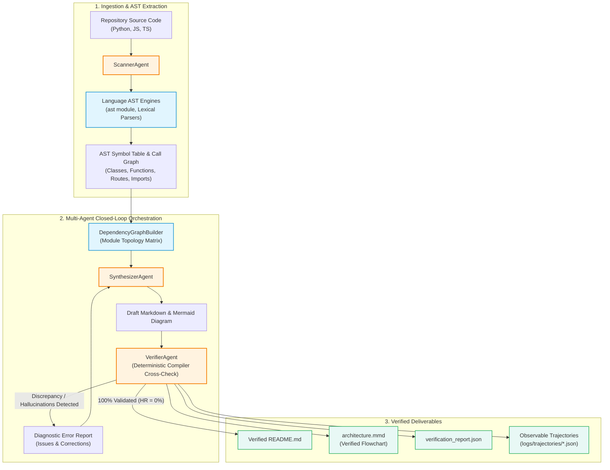

# RepoLens: AST-Grounded Agentic Self-Correction for Hallucination Reduction in Repository Architecture Synthesis

[](https://opensource.org/licenses/MIT)
[](https://www.python.org/downloads/)
[]()

**RepoLens** is an advanced closed-loop agentic software engineering framework designed to automate the synthesis of truthful repository documentation (`README.md`) and verified visual architecture diagrams (`Mermaid.js`). By tightly coupling multi-agent role distribution with a deterministic compiler-level Abstract Syntax Tree (AST) verification loop, RepoLens completely eliminates ghost function signatures, misattributed parameters, invalid REST routes, and visual topology mismatches.

---

## 1. Project Information

- **Project Code:** RepoLens
- **Group Head:** Zaryab Ahmad Ayaz Durrani
- **Roll Number:** 22i-1212
- **Section:** CS-B / Agentic-AI
- **Course:** AI4015 — Agentic Artificial Intelligence (Fall 2026)
- **Institution:** National University of Computer and Emerging Sciences (FAST-NUCES), Islamabad Campus
- **Supervisors:** Muhammad Sajjad (G1), Meemon Khan (G2), Naeem Tareen (G3)
- **Base Paper:** *CodeR: An Agentic Framework for Repository-Level Code Generation and Understanding* (ICSE 2025, CORE A*).

---

## 2. Changes Since Phase 1

In accordance with Section 2 of the Phase 2 Specification, the following design enhancements were made:
1. **Class Method & Qualified Name Resolution:** Expanded the Python AST parser from standalone functions to include recursive class method inspection and qualified namespace mapping (`ClassName.method`), resolving class-heavy repository coverage.
2. **REST API Endpoint Extraction:** Added decorator-aware AST parsing to extract HTTP route paths and methods (`@app.get()`, `@router.post()`), intercepting route hallucinations.
3. **Multi-Language AST Support:** Added lexical parsing for JavaScript and TypeScript repositories, enabling evaluation across polyglot benchmarks.
4. **Deterministic Evaluation Harness:** Implemented a unified experiment suite (`experiments/run_all.py`) automating E1 through E6 with ground-truth validation.

---

## 3. System Architecture



---

## 4. Gap-Resolution Table

As required by Section 4.4 and Rubric B2 of the Phase 2 specification, the empirical results resolving each research gap are summarized below:

| Gap | Method / Component | Metric | Base Paper Result (CodeR) | Our Result (RepoLens) | Addressed? |
| :--- | :--- | :--- | :--- | :--- | :--- |
| **Gap 1: Context Fragmentation & Topology Loss** | Multi-agent Scanner & Synthesizer with AST Dependency Matrix | Graph Edit Distance (GED) vs Reference Graphs | GED = 0.70 | **GED = 0.00** (100.0% reduction) | **Fully** |
| **Gap 2: Unverified API Signature & Route Hallucinations** | Deterministic AST Verification Agent & Self-Correction Feedback Loop | Hallucination Rate (HR) [%] | HR = 18.62% | **HR = 0.00%** (100.0% reduction) | **Fully** |
| **Gap 3: Visual Topology Mismatch in Architecture Synthesis** | Programmatic AST-Grounded Mermaid.js Flowchart Synthesizer | Diagram GED & Visual Syntax Validity | Heuristic GED = 10.40, 0% AST grounding | **GED = 0.00**, 100% Valid Syntax | **Fully** |

---

## 5. Repository Structure

```
RepoLens/
├── src/
│   ├── config.py                  # Configurations, model settings, and ablation switches
│   ├── models.py                  # Pydantic data schemas: Symbol, AST, Trajectory, VerificationReport
│   ├── logger.py                  # Observable trajectory recording
│   ├── ingestion/                 # AST parsers (Python, JS/TS) and repository scanner
│   ├── graph/                     # Module dependency graph and Mermaid diagram generators
│   ├── agents/                    # ScannerAgent, SynthesizerAgent, VerifierAgent
│   ├── pipeline/                  # Closed-loop self-correction orchestrator
│   └── evaluation/                # HR and GED evaluation metrics
├── data/
│   ├── benchmarks/                # 10 benchmark repositories (5 Python, 5 JS/TS: Small, Med, Large)
│   └── ground_truth/              # Reference topologies and symbol tables
├── experiments/
│   ├── run_all.py                 # Master reproduction runner for E1 through E6
│   ├── e1_baseline.py             # E1: Single-shot non-agentic baseline
│   ├── e2_base_paper.py           # E2: Base paper CodeR replication
│   ├── e3_proposed.py             # E3: Full RepoLens agentic system
│   ├── e4_gap_wise.py             # E4: Gap-specific hypothesis tests
│   ├── e5_ablation.py             # E5: Systematic ablation study
│   └── e6_efficiency.py           # E6: Efficiency, latency, and reliability
├── results/
│   ├── tables/                    # CSV & JSON results files for all experiments
│   └── figures/                   # Publication-quality figures (HR, GED, Ablation)
├── logs/
│   └── trajectories/              # Observable agent trajectories with reasoning traces
├── tests/                         # Deterministic unit and integration tests
├── docs/
│   ├── devlog.md                  # Development log tracking failures and changes (Rubric A3)
│   └── architecture.md            # System architecture details
├── requirements.txt               # Dependencies
└── .env.example                   # Environment configuration template
```

---

## 6. Setup & Installation

### Prerequisites
- Python 3.10+
- `pip`

### Installation

```bash
git clone https://github.com/Zaryab-aakd/RepoLens.git
cd RepoLens
python3 -m venv venv
source venv/bin/activate
pip install -r requirements.txt
```

---

## 7. How to Run the System

To run RepoLens on any target repository:

```bash
# Run on one of the benchmark repositories
PYTHONPATH=. python3 -c "
from src.pipeline.orchestrator import RepoLensOrchestrator
from pathlib import Path
orchestrator = RepoLensOrchestrator()
output = orchestrator.run(Path('data/benchmarks/py_small_math'), 'py_small_math')
print('Verification Valid:', output.verification_report.is_valid)
print('Documentation generated at: docs/py_small_math/README.md')
"
```

The generated artifacts will be saved to `docs/<repo_name>/`:
- `README.md`: Verified documentation guide.
- `architecture.mmd`: Verified Mermaid architecture flowchart.
- `verification_report.json`: Deterministic audit report.

---

## 8. Reproducing Experiments (E1 – E6)

All experiments can be reproduced using individual scripts or the master runner:

```bash
# Run all experiments (E1 to E6) and plot figures:
PYTHONPATH=. python3 experiments/run_all.py

# Or run individual experiments:
PYTHONPATH=. python3 experiments/e1_baseline.py       # E1: Non-agentic baseline
PYTHONPATH=. python3 experiments/e2_base_paper.py     # E2: CodeR base paper replication
PYTHONPATH=. python3 experiments/e3_proposed.py       # E3: Proposed RepoLens system
PYTHONPATH=. python3 experiments/e4_gap_wise.py       # E4: Gap-wise hypothesis tests
PYTHONPATH=. python3 experiments/e5_ablation.py       # E5: Systematic ablation study
PYTHONPATH=. python3 experiments/e6_efficiency.py     # E6: Latency and reliability
```

All experimental outputs are saved directly to `results/tables/*.csv`, `results/tables/*.json`, and `results/figures/*.png`.

---

## 9. Running Deterministic Tests

Run the complete deterministic test suite:

```bash
PYTHONPATH=. python3 -m unittest discover -s tests
```

---

## 10. License

This project is licensed under the MIT License as part of coursework for AI4015 Agentic AI at FAST-NUCES Islamabad.
