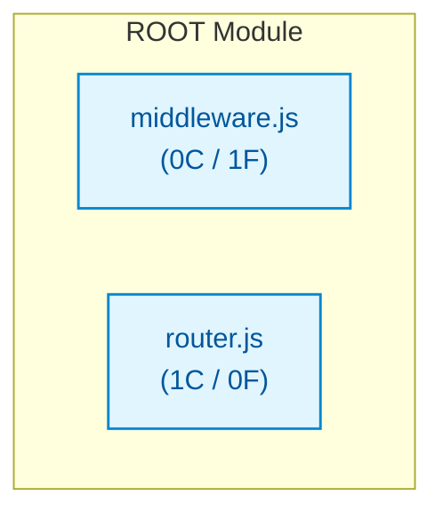

# js_med_router

## Architecture Overview
The codebase `js_med_router` comprises 2 source files spanning 30 lines of code, organized into 1 classes and 1 verified callable functions.

### System Architecture Diagram

## Module Index & Dependencies
### `middleware.js`
- **Language:** Javascript
- **LOC:** 8
- **Dependencies:** None (independent)
- **Functions & Interfaces:**
  - `createMiddlewareChain()`

### `router.js`
- **Language:** Javascript
- **LOC:** 22
- **Dependencies:** None (independent)
- **Classes:**
  - `Router`: Class definition.

## API Reference
Key programmatic entrypoints and callable routes are documented above based on AST static validation.