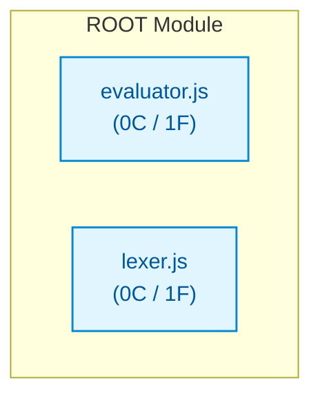

# js_small_calculator

## Architecture Overview
The codebase `js_small_calculator` comprises 2 source files spanning 19 lines of code, organized into 0 classes and 2 verified callable functions.

### System Architecture Diagram

## Module Index & Dependencies
### `evaluator.js`
- **Language:** Javascript
- **LOC:** 15
- **Dependencies:** None (independent)
- **Functions & Interfaces:**
  - `evaluateExpression(expr)`

### `lexer.js`
- **Language:** Javascript
- **LOC:** 4
- **Dependencies:** None (independent)
- **Functions & Interfaces:**
  - `tokenize(expr)`

## API Reference
Key programmatic entrypoints and callable routes are documented above based on AST static validation.