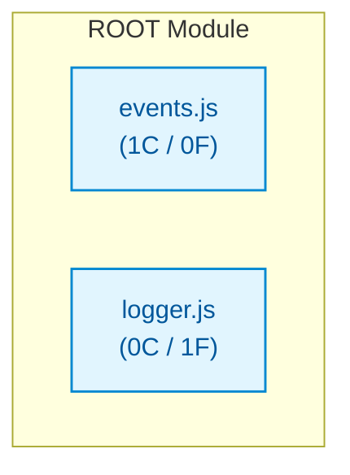

# js_small_eventemitter

## Architecture Overview
The codebase `js_small_eventemitter` comprises 2 source files spanning 21 lines of code, organized into 1 classes and 1 verified callable functions.

### System Architecture Diagram

## Module Index & Dependencies
### `events.js`
- **Language:** Javascript
- **LOC:** 15
- **Dependencies:** None (independent)
- **Classes:**
  - `EventEmitter`: Class definition.

### `logger.js`
- **Language:** Javascript
- **LOC:** 6
- **Dependencies:** None (independent)
- **Functions & Interfaces:**
  - `attachLogger(emitter)`

## API Reference
Key programmatic entrypoints and callable routes are documented above based on AST static validation.