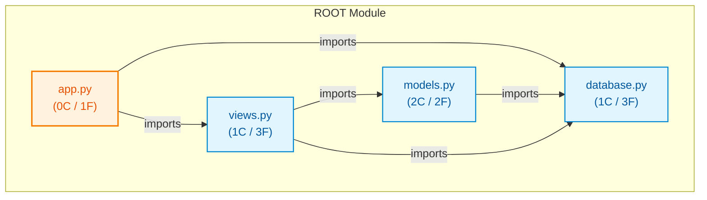

# py_large_cms

## Architecture Overview
The codebase `py_large_cms` comprises 4 source files spanning 41 lines of code, organized into 4 classes and 9 verified callable functions.

### System Architecture Diagram

## Module Index & Dependencies
### `app.py`
- **Language:** Python
- **LOC:** 7
- **Dependencies:** database.py, views.py
- **Functions & Interfaces:**
  - `create_cms_app(db_uri) -> CMSController`

### `database.py`
- **Language:** Python
- **LOC:** 10
- **Dependencies:** None (independent)
- **Classes:**
  - `DatabaseConnection`: Class definition.
- **Functions & Interfaces:**
  - `DatabaseConnection.__init__(uri)`
  - `DatabaseConnection.connect() -> bool`
  - `DatabaseConnection.query(sql) -> list`

### `models.py`
- **Language:** Python
- **LOC:** 12
- **Dependencies:** database.py
- **Classes:**
  - `Post`: Class definition.
  - `Author`: Class definition.
- **Functions & Interfaces:**
  - `Post.__init__(post_id, title, content)`
  - `Author.__init__(author_id, name, email)`

### `views.py`
- **Language:** Python
- **LOC:** 12
- **Dependencies:** models.py, database.py
- **Classes:**
  - `CMSController`: Class definition.
- **Functions & Interfaces:**
  - `CMSController.__init__(db)`
  - `CMSController.get_post_detail(post_id) -> dict`
  - `CMSController.publish_post(title, content, author_id) -> int`

## API Reference
Key programmatic entrypoints and callable routes are documented above based on AST static validation.