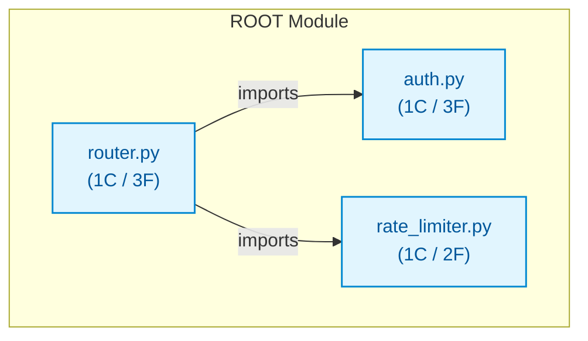

# py_med_apigateway

## Architecture Overview
The codebase `py_med_apigateway` comprises 3 source files spanning 36 lines of code, organized into 3 classes and 8 verified callable functions.

### System Architecture Diagram

## Module Index & Dependencies
### `auth.py`
- **Language:** Python
- **LOC:** 8
- **Dependencies:** None (independent)
- **Classes:**
  - `AuthProvider`: Class definition.
- **Functions & Interfaces:**
  - `AuthProvider.__init__(secret)`
  - `AuthProvider.authenticate_token(token) -> bool`
  - `AuthProvider.generate_token(user_id) -> str`

### `rate_limiter.py`
- **Language:** Python
- **LOC:** 11
- **Dependencies:** None (independent)
- **Classes:**
  - `RateLimiter`: Class definition.
- **Functions & Interfaces:**
  - `RateLimiter.__init__(max_requests)`
  - `RateLimiter.is_allowed(client_ip) -> bool`

### `router.py`
- **Language:** Python
- **LOC:** 17
- **Dependencies:** auth.py, rate_limiter.py
- **Classes:**
  - `APIGateway`: Class definition.
- **Functions & Interfaces:**
  - `APIGateway.__init__(secret, rate_limit)`
  - `APIGateway.route_get(path, token, ip) -> str`
  - `APIGateway.route_post(path, payload, token) -> str`

## API Reference
Key programmatic entrypoints and callable routes are documented above based on AST static validation.