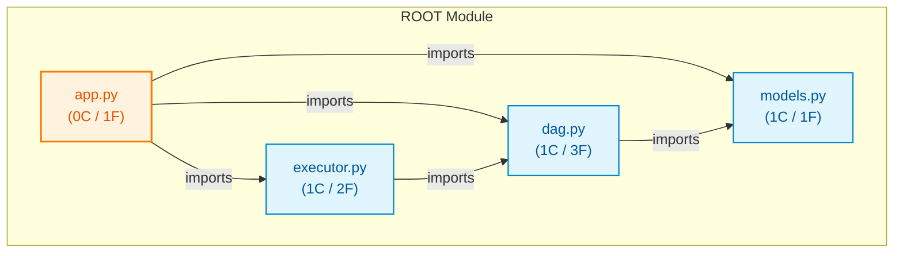

# py_med_taskflow

## Architecture Overview
The codebase `py_med_taskflow` comprises 4 source files spanning 53 lines of code, organized into 3 classes and 7 verified callable functions.

### System Architecture Diagram

## Module Index & Dependencies
### `app.py`
- **Language:** Python
- **LOC:** 10
- **Dependencies:** models.py, dag.py, executor.py
- **Functions & Interfaces:**
  - `build_sample_pipeline() -> int`

### `dag.py`
- **Language:** Python
- **LOC:** 21
- **Dependencies:** models.py
- **Classes:**
  - `TaskDAG`: Class definition.
- **Functions & Interfaces:**
  - `TaskDAG.__init__()`
  - `TaskDAG.add_task(task)`
  - `TaskDAG.get_execution_order() -> List[str]`

### `executor.py`
- **Language:** Python
- **LOC:** 14
- **Dependencies:** dag.py
- **Classes:**
  - `TaskExecutor`: Class definition.
- **Functions & Interfaces:**
  - `TaskExecutor.__init__(dag)`
  - `TaskExecutor.execute_all() -> int`

### `models.py`
- **Language:** Python
- **LOC:** 8
- **Dependencies:** None (independent)
- **Classes:**
  - `Task`: Class definition.
- **Functions & Interfaces:**
  - `Task.__init__(task_id, action, dependencies)`

## API Reference
Key programmatic entrypoints and callable routes are documented above based on AST static validation.