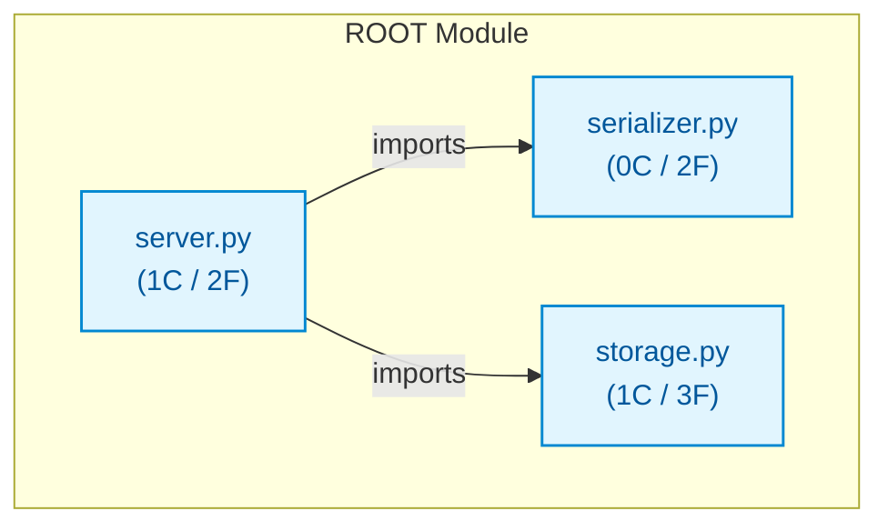

# py_small_kv

## Architecture Overview
The codebase `py_small_kv` comprises 3 source files spanning 36 lines of code, organized into 2 classes and 7 verified callable functions.

### System Architecture Diagram

## Module Index & Dependencies
### `serializer.py`
- **Language:** Python
- **LOC:** 6
- **Dependencies:** None (independent)
- **Functions & Interfaces:**
  - `serialize_payload(obj) -> str`
  - `deserialize_payload(raw) -> dict`

### `server.py`
- **Language:** Python
- **LOC:** 14
- **Dependencies:** storage.py, serializer.py
- **Classes:**
  - `KVServer`: Class definition.
- **Functions & Interfaces:**
  - `KVServer.__init__()`
  - `KVServer.handle_request(command, key, value) -> str`

### `storage.py`
- **Language:** Python
- **LOC:** 16
- **Dependencies:** None (independent)
- **Classes:**
  - `StorageEngine`: Class definition.
- **Functions & Interfaces:**
  - `StorageEngine.__init__()`
  - `StorageEngine.set(key, value, ttl)`
  - `StorageEngine.get(key) -> str`

## API Reference
Key programmatic entrypoints and callable routes are documented above based on AST static validation.