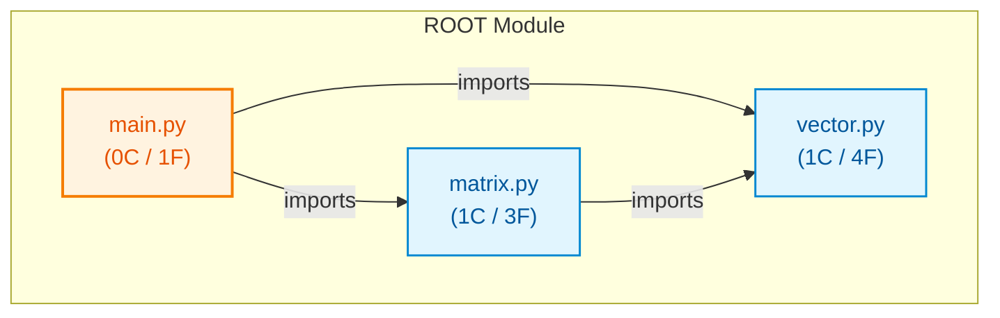

# py_small_math

## Architecture Overview
The codebase `py_small_math` comprises 3 source files spanning 37 lines of code, organized into 2 classes and 8 verified callable functions.

### System Architecture Diagram

## Module Index & Dependencies
### `main.py`
- **Language:** Python
- **LOC:** 8
- **Dependencies:** vector.py, matrix.py
- **Functions & Interfaces:**
  - `run_math_pipeline(scale) -> float`

### `matrix.py`
- **Language:** Python
- **LOC:** 13
- **Dependencies:** vector.py
- **Classes:**
  - `Matrix2x2`: Represents a 2x2 matrix.
- **Functions & Interfaces:**
  - `Matrix2x2.__init__(a, b, c, d)`
  - `Matrix2x2.determinant() -> float`
  - `Matrix2x2.transform(v) -> Vector2D`

### `vector.py`
- **Language:** Python
- **LOC:** 16
- **Dependencies:** None (independent)
- **Classes:**
  - `Vector2D`: Represents a 2D vector.
- **Functions & Interfaces:**
  - `Vector2D.__init__(x, y)`
  - `Vector2D.magnitude() -> float`
  - `Vector2D.normalize() -> 'Vector2D'`
  - `dot_product(v1, v2) -> float`

## API Reference
Key programmatic entrypoints and callable routes are documented above based on AST static validation.