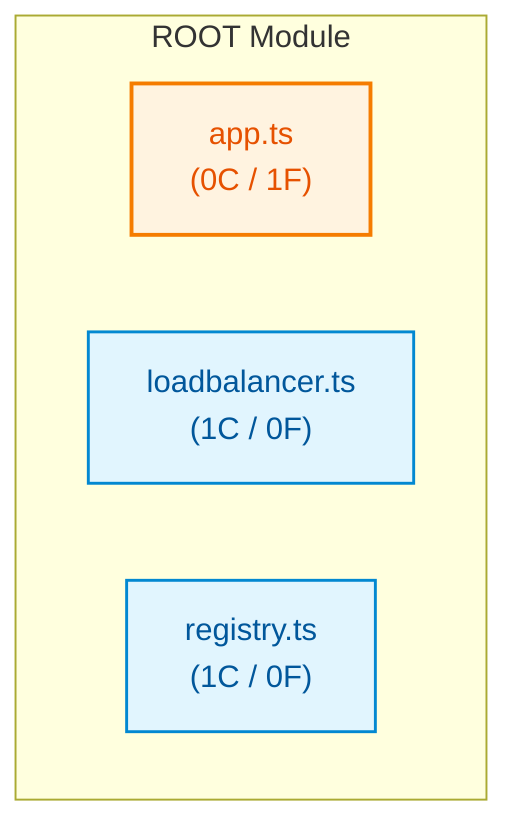

# ts_large_orchestrator

## Architecture Overview
The codebase `ts_large_orchestrator` comprises 3 source files spanning 38 lines of code, organized into 2 classes and 1 verified callable functions.

### System Architecture Diagram

## Module Index & Dependencies
### `app.ts`
- **Language:** Typescript
- **LOC:** 8
- **Dependencies:** None (independent)
- **Functions & Interfaces:**
  - `bootstrapCluster()`

### `loadbalancer.ts`
- **Language:** Typescript
- **LOC:** 15
- **Dependencies:** None (independent)
- **Classes:**
  - `LoadBalancer`: Class definition.

### `registry.ts`
- **Language:** Typescript
- **LOC:** 15
- **Dependencies:** None (independent)
- **Classes:**
  - `ServiceRegistry`: Class definition.

## API Reference
Key programmatic entrypoints and callable routes are documented above based on AST static validation.