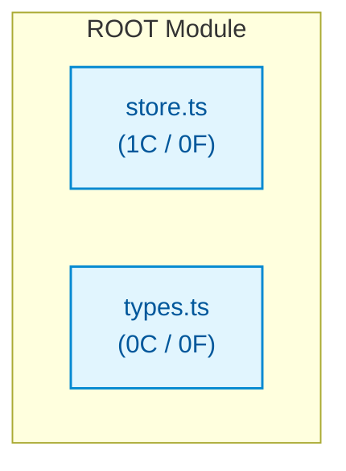

# ts_med_store

## Architecture Overview
The codebase `ts_med_store` comprises 2 source files spanning 23 lines of code, organized into 1 classes and 0 verified callable functions.

### System Architecture Diagram

## Module Index & Dependencies
### `store.ts`
- **Language:** Typescript
- **LOC:** 15
- **Dependencies:** None (independent)
- **Classes:**
  - `Store`: Class definition.

### `types.ts`
- **Language:** Typescript
- **LOC:** 8
- **Dependencies:** None (independent)

## API Reference
Key programmatic entrypoints and callable routes are documented above based on AST static validation.